  

<!-- Social Links & Badges Row -->

  
  
  
  
  

<!-- Technical Stack & Tooling Section -->
<h2 align="center">🛠️ Technical Stack & Tooling</h2>

<b>Core Languages</b>

  

<b>Backend & Databases</b>

  

<b>Tools & Hosting</b>

  

 

<!-- Currently Learning Section -->
<h2 align="center">🌱 Currently Learning</h2>

<b>Languages & Frameworks</b>

  

<b>AI, Cloud & DevOps</b>

  

## ⭐ Start Here

- 🌐 [updated_portfolio](https://github.com/Maxwel12744/updated_portfolio): my personal portfolio.
- 🔐 [glassmorphism_login](https://github.com/Maxwel12744/REPO-NAME): login and registration system with a glassmorphism interface.
- 🎮 [cautious_fishstick](https://github.com/Maxwel12744/cautious_fishstick): Adds the students marks and display the result
- 🛒 [xtreme-parking-system-application](https://github.com/Maxwel12744/xtreme-parking-system-application): A smart parking system

## 🚀 Current Projects

### 🌐 Web & Applications

- 🌐 [updated_portfolio](https://github.com/Maxwel12744/updated_portfolio): multi-page portfolio and an admin dashboard. Deployed on Vercel: [odhiambo-maxwel.vercel.app](https://odhiambo-maxwel.vercel.app)
- 🔐 [glassmorphism_login](https://github.com/Maxwel12744/glassmorphism_login): user registration, login and a home page listing registered users, with a frosted-glass design
- 🧩 [xtreme-parking-system-application](https://github.com/Maxwel12744/xtreme-parking-system-application): A smart parking system

- ### 🎮 Games & Experiments

- 🐍 [snake-game](https://github.com/Maxwel12744/snake-game): A snake game build with Javascript

### 🌱 Currently Learning

- 🤖 Machine learning and AI fundamentals
- ⚙️ Building more with Django, MySQL and deployment
  🌐 Live site: [odhiambo-maxwel.vercel.app](https://odhiambo-maxwel.vercel.app)

## 🔭 What I'm Doing

- **Studying** — Second-year BSc Computer Science at Multimedia University of Kenya
- **Building** — Full-stack web apps with Django and MySQL
- **Learning** — Machine learning and AI, and how to bring them into the software I build
- **Shipping in public** — My projects land on GitHub, and I deploy them on Vercel

## 📊 GitHub Activity

---

### 💭 Philosophy

> "Learn by building." I turn what I study into real projects, then share them so I can learn from the feedback. Currently exploring how machine learning and AI are changing software development.

Random Facts

- 🎓 I study Computer Science at Multimedia University of Kenya
- 🌍 I'm based in Kenya
- ⌨️ My favourite part of coding is [what you enjoy most]
- 🎧 Outside coding, I enjoy [your hobby]

